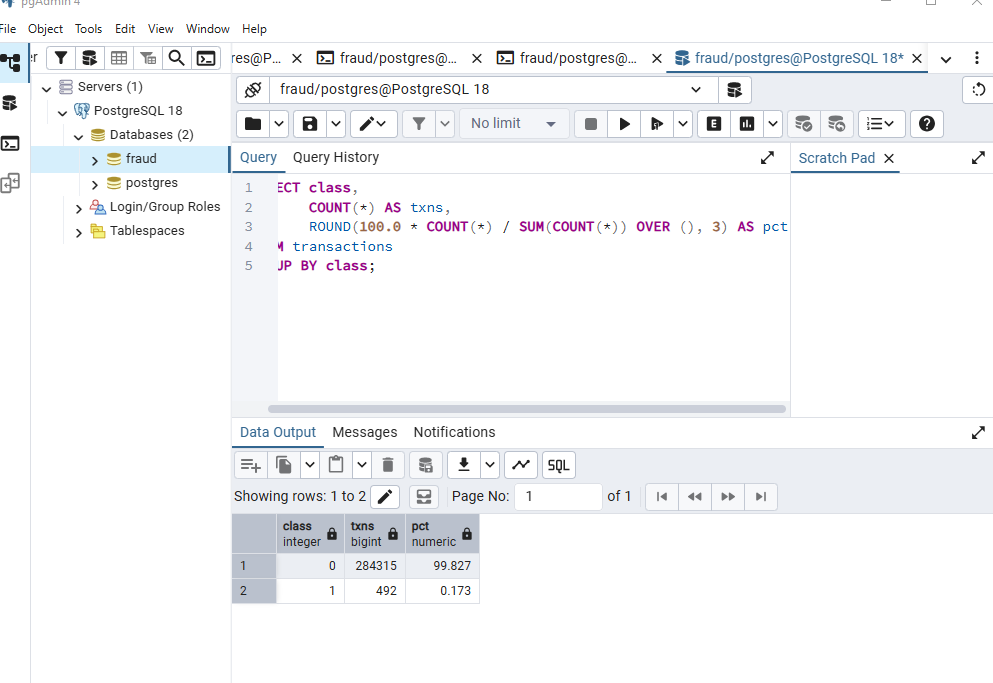
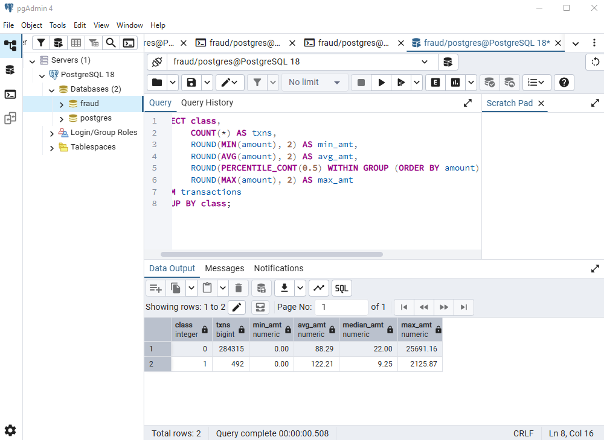
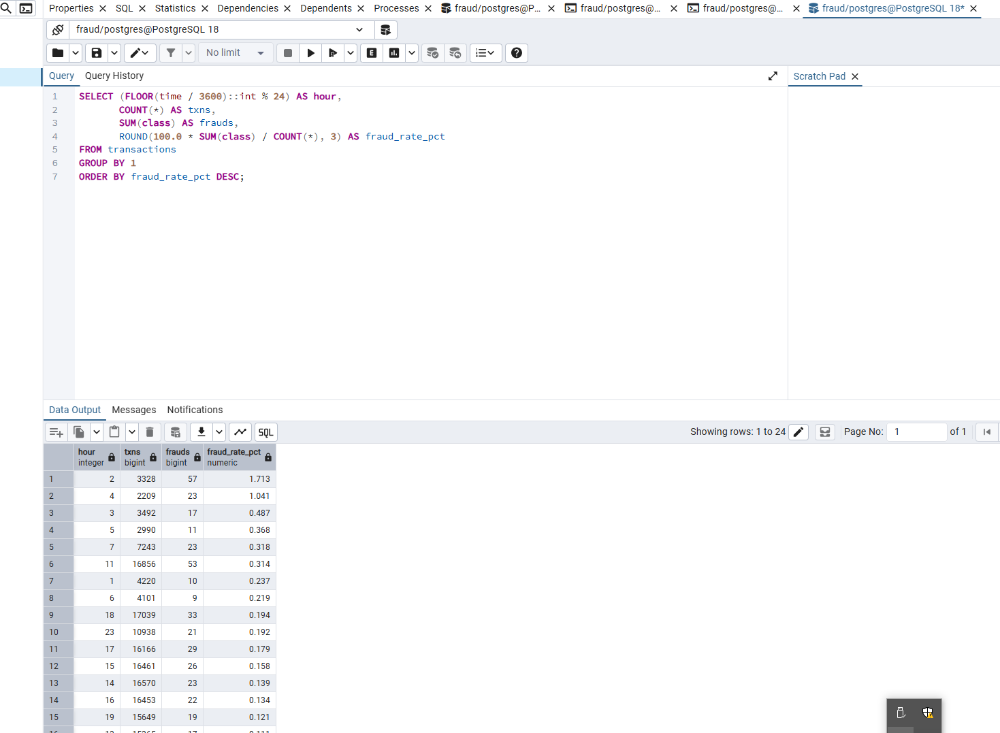
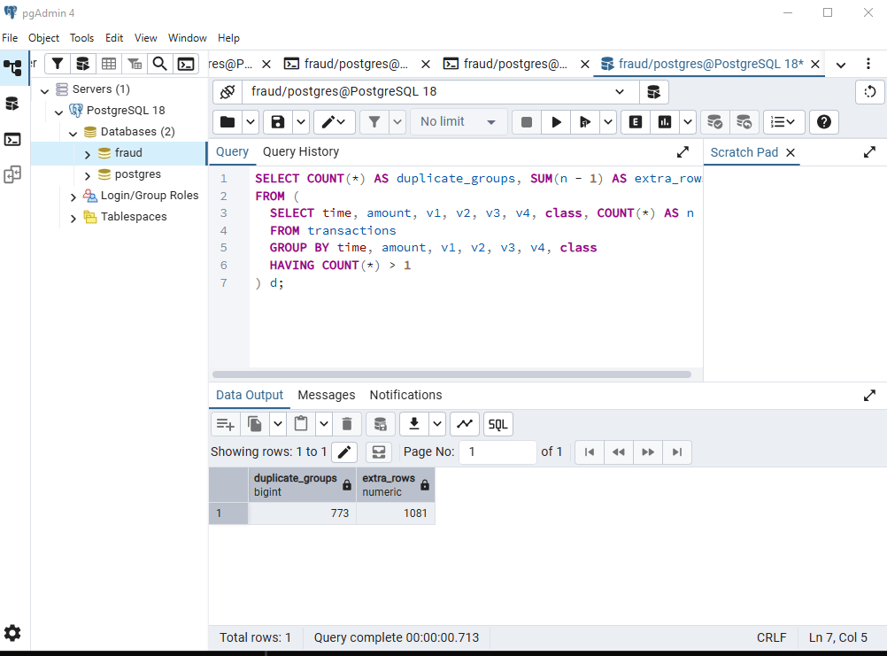
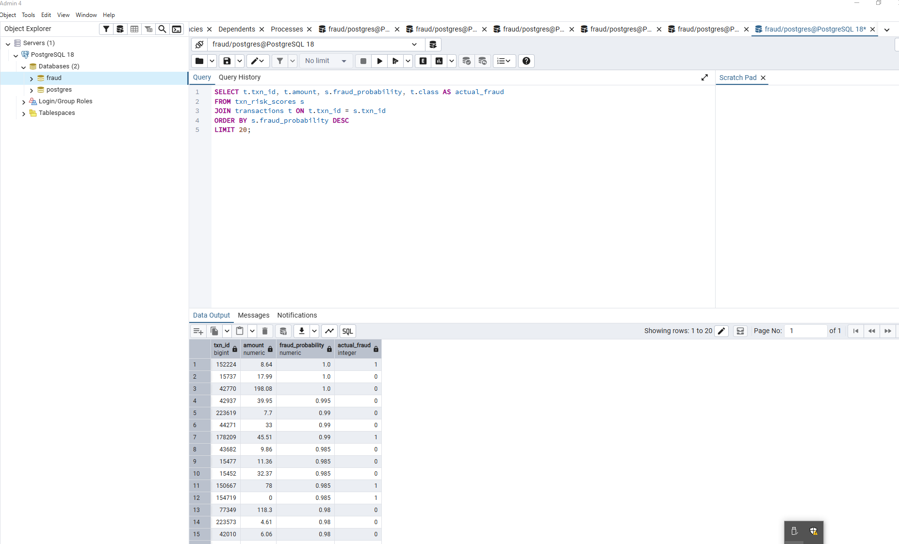
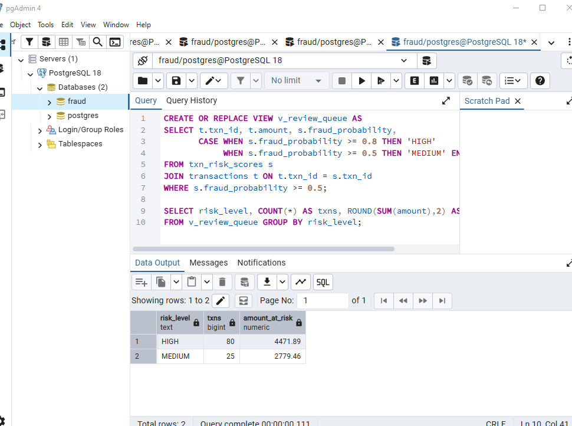

# Credit Card Fraud Analysis (SQL + Python)

I wanted to see what credit card fraud actually looks like in data. I took 284,807 transactions, explored them in PostgreSQL, trained a model in Google Colab, and then put the model's scores back into the database.

**Tools:** PostgreSQL, pgAdmin, Python (Colab)
**Data:** [Kaggle – Credit Card Fraud](https://www.kaggle.com/datasets/mlg-ulb/creditcardfraud). It isn't included here because it's too big for GitHub.

## What I found

- Fraud is rare: only **492** of 284,807 transactions (0.17%)
- Fraud is usually **small**: the median is 9.25, vs 22 for normal transactions
- **Hour 2** had a fraud rate about 10x the normal rate
- **1,081** duplicate rows, which I removed before training

---

## Loading the data

```sql
-- table with one column per CSV column
CREATE TABLE transactions (
  time NUMERIC, v1 NUMERIC, /* ... */ v28 NUMERIC,
  amount NUMERIC, class INT
);

-- this only works in psql, not pgAdmin's Query Tool
\copy transactions FROM 'C:/path/to/creditcard.csv' WITH (FORMAT csv, HEADER true);

-- row ID, so the model scores can be joined back later
ALTER TABLE transactions ADD COLUMN txn_id BIGSERIAL PRIMARY KEY;
```

## How much fraud is there?

```sql
-- count and percent for each class
SELECT class, COUNT(*) AS txns,
       ROUND(100.0 * COUNT(*) / SUM(COUNT(*)) OVER (), 3) AS pct
FROM transactions
GROUP BY class;
```


Less than 1%. A model could say "not fraud" every time and still be 99.8% accurate, so accuracy doesn't tell you much here.

## Are fraud amounts different?

```sql
-- average vs median amount for each class
SELECT class,
       ROUND(AVG(amount), 2) AS avg_amt,
       ROUND(PERCENTILE_CONT(0.5) WITHIN GROUP (ORDER BY amount)::numeric, 2) AS median_amt,
       ROUND(MAX(amount), 2) AS max_amt
FROM transactions
GROUP BY class;
```


The average fraud is higher than the average normal transaction, but the median fraud is lower. So most fraud is small, and a few large ones push the average up.

## Which hours are risky?

```sql
-- convert seconds to hour (0-23), then fraud rate per hour
SELECT (FLOOR(time / 3600)::int % 24) AS hour,
       COUNT(*) AS txns, SUM(class) AS frauds,
       ROUND(100.0 * SUM(class) / COUNT(*), 3) AS fraud_rate_pct
FROM transactions
GROUP BY 1
ORDER BY fraud_rate_pct DESC;
```


Hours 2 to 5 had the most fraud and the fewest transactions. `Time` starts from the first transaction, not midnight, so these aren't exact clock hours.

## Duplicates

```sql
-- same values showing up more than once
SELECT COUNT(*) AS duplicate_groups, SUM(n - 1) AS extra_rows
FROM (
  SELECT time, amount, v1, v2, v3, v4, class, COUNT(*) AS n
  FROM transactions
  GROUP BY time, amount, v1, v2, v3, v4, class
  HAVING COUNT(*) > 1
) d;
```


---

## The model (Colab)

The Python file is in this repo. Here's what it does, step by step:

1. **Load the data**: uploaded `creditcard.csv` and gave every row an ID (`txn_id`), the same as in SQL
2. **Look at the data**: made charts of fraud vs normal, amounts, hours, and which features relate most to fraud
3. **Clean it**: removed duplicate rows
4. **Split it**: 70% to train, 30% to test, with the same fraud ratio in both
5. **Scale it**: put `time` and `amount` on the same scale as the other features
6. **Train two models**: Logistic Regression (simple) and Random Forest (stronger), both told to pay more attention to fraud because it's so rare
7. **Check the results**: used precision and recall instead of accuracy
8. **Save the scores**: exported each test transaction's fraud probability to a CSV and loaded it into PostgreSQL (next section)

## Scores back in SQL

```sql
-- table for the scores I exported from Colab
CREATE TABLE txn_risk_scores (txn_id BIGINT, fraud_probability NUMERIC);

-- file is in C:\Users\Public because PostgreSQL can't read my Downloads folder
COPY txn_risk_scores FROM 'C:/Users/Public/txn_risk_scores.csv' WITH (FORMAT csv, HEADER true);

-- top 20 riskiest transactions next to the real answer
SELECT t.txn_id, t.amount, s.fraud_probability, t.class AS actual_fraud
FROM txn_risk_scores s
JOIN transactions t ON t.txn_id = s.txn_id
ORDER BY s.fraud_probability DESC
LIMIT 20;
```


## Did the model work?

```sql
-- flagged or passed vs real fraud or normal
SELECT CASE WHEN s.fraud_probability >= 0.5 THEN 'Flagged' ELSE 'Passed' END AS decision,
       SUM(CASE WHEN t.class = 1 THEN 1 ELSE 0 END) AS real_fraud,
       SUM(CASE WHEN t.class = 0 THEN 1 ELSE 0 END) AS normal
FROM txn_risk_scores s
JOIN transactions t ON t.txn_id = s.txn_id
GROUP BY 1;
```

| | Real fraud | Normal |
|---|---|---|
| Flagged | 33 | 72 |
| Passed | 118 | 84,895 |

It caught 33 of 151 frauds. That's not good enough yet. Next I want to lower the threshold so it catches more, even if that means a few more false alarms.

## A list for the fraud team

```sql
-- flagged transactions sorted into HIGH and MEDIUM risk
CREATE OR REPLACE VIEW v_review_queue AS
SELECT t.txn_id, t.amount, s.fraud_probability,
       CASE WHEN s.fraud_probability >= 0.8 THEN 'HIGH' ELSE 'MEDIUM' END AS risk_level
FROM txn_risk_scores s
JOIN transactions t ON t.txn_id = s.txn_id
WHERE s.fraud_probability >= 0.5;

-- how many transactions and how much money in each level
SELECT risk_level, COUNT(*) AS txns, ROUND(SUM(amount), 2) AS amount_at_risk
FROM v_review_queue
GROUP BY risk_level;
```


80 HIGH and 25 MEDIUM. In real life, a team would check the HIGH ones first.

---

## Things I got stuck on

- `\copy` didn't work in pgAdmin. It only works in psql.
- PostgreSQL couldn't read files in my Downloads folder. Moving the file to `C:\Users\Public` fixed it.
- Colab can't connect to my laptop's database, so I passed the data with a CSV.
- When Colab restarted, I had to run all the cells again.

## Limits

- V1–V28 are hidden features, so I can't say what they mean
- Only 2 days of data, from 2013
- I only used one train/test split

